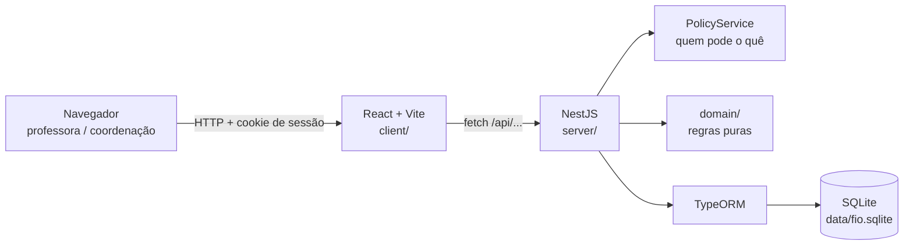
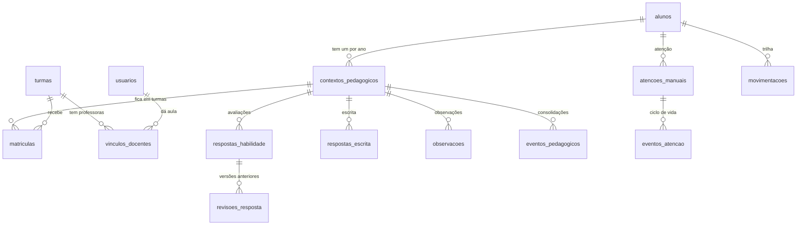
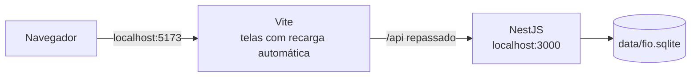

# Arquitetura — Fio da Aprendizagem

Este documento explica como o sistema está organizado: a stack, as camadas, os módulos, o modelo de dados, a segurança e a forma de rodar e testar. As decisões de projeto que justificam cada escolha estão em [`design.md`](../openspec/changes/especificar-fio-da-aprendizagem/design.md) (D01 a D17); aqui está o resultado implementado.

## 1. Visão geral

O Fio da Aprendizagem é **uma aplicação web única** (D01): um servidor **NestJS** que expõe uma API REST em `/api` e, em produção, também entrega as telas **React** já compiladas. Os dados ficam num único arquivo **SQLite**.

O código é um **monorepo com npm workspaces**:

- `server/` — API, regras de negócio e banco.
- `client/` — interface web.



## 2. Stack

| Camada | Tecnologia | Versão | Para quê |
| --- | --- | --- | --- |
| Linguagem | TypeScript | 5.7 | Servidor e cliente com tipos |
| Execução | Node.js | 20 ou maior (desenvolvido com 24) | Roda o servidor e as ferramentas |
| Servidor | NestJS (`@nestjs/core`, `platform-express`) | 11 | Módulos, controllers, injeção de dependência |
| Banco | SQLite com `better-sqlite3` | 12 | Arquivo único, transações, sem instalar servidor de banco |
| Acesso a dados | TypeORM | 0.3 | Entidades e consultas; o esquema nasce das entidades (`synchronize`) |
| Senhas | bcryptjs | 2.4 | Hash das senhas (nunca em texto simples) |
| Interface | React | 18 | Telas |
| Rotas da interface | react-router-dom | 6.30 | Navegação e bloqueio de saída com alterações não salvas |
| Dados na interface | TanStack Query | 5 | Busca, cache e atualização dos dados da API |
| Build da interface | Vite | 6 | Servidor de desenvolvimento e build |
| Estilo | Tailwind CSS | 4 | Visual (degradê verde-azulado, cartões) |
| Fonte | Nunito (`@fontsource-variable/nunito`) | 5 | Tipografia, embutida (sem internet) |
| Testes | Jest + ts-jest | 29 | 168 testes automáticos do servidor |
| Utilitário | concurrently | 9 | Sobe servidor e cliente juntos no `npm run dev` |

Não há serviço externo, CDN, banco remoto nem inteligência artificial em execução: tudo roda localmente.

## 3. Estrutura de pastas

```
fio-da-aprendizagem/
├── server/src/
│   ├── main.ts                 # inicia o NestJS (porta 3000) e serve client/dist em produção
│   ├── app.module.ts           # junta todos os módulos
│   ├── common/                 # peças transversais
│   │   ├── auth.ts             #   guard global de sessão, @Public, @UsuarioAtual
│   │   ├── erros.ts            #   erro padronizado { codigo, mensagem }
│   │   ├── exclusivo.ts        #   fila de escrita (uma gravação por vez)
│   │   ├── relogio.ts          #   "hoje" no fuso America/Sao_Paulo (fixável nos testes)
│   │   └── sequence.ts         #   ordem global de registro
│   ├── domain/                 # REGRAS PURAS (sem banco, sem NestJS)
│   ├── modules/                # um módulo por assunto (seção 4)
│   ├── database/
│   │   ├── entities/           #   tabelas (seção 6)
│   │   ├── seed/               #   catálogo CAT-v1 e escola fictícia
│   │   └── data-source.ts      #   caminho do banco (DB_PATH) e configuração
│   ├── operacao/               # cópia de segurança e restauração (CLI)
│   ├── desempenho/             # medição de desempenho com 500 alunos (CLI)
│   └── test-utils/             # base de teste em memória
├── client/src/
│   ├── main.tsx, App.tsx       # entrada, layout com menu lateral, rotas
│   ├── api.ts                  # chamada à API e tipos das respostas
│   ├── pages/                  # uma tela por arquivo (seção 7)
│   ├── components/             # peças reutilizadas (cartões, avatar, ícones…)
│   └── index.css               # tokens de cor e classes visuais
├── data/                       # fio.sqlite e backups (fora do git)
├── docs/                       # requisitos, relatório, roteiro, guias e evidências
└── openspec/                   # proposta, design, specs e tarefas
```

## 4. Servidor

### 4.1 Camadas

Cada pedido passa sempre pelo mesmo caminho:

1. **Guard de sessão** (`common/auth.ts`): toda rota exige login, exceto `/api/auth/login`, `/api/auth/logout` e `/api/health`. A pessoa é **recarregada do banco a cada pedido**, então desativar uma conta corta o acesso na hora.
2. **Controller** do módulo: recebe o pedido e repassa ao serviço.
3. **Serviço**: valida os dados, pede autorização ao **PolicyService** e grava ou consulta.
4. **PolicyService** (`modules/acesso/policy.service.ts`): o **único lugar** que decide permissões (papel + vínculo vigente + autoria + situação do bimestre). Nenhum controller decide sozinho (D16).
5. **domain/**: funções puras que calculam lacunas, atenção, indicadores e porcentagens. São as mesmas usadas pela ficha, pelo painel e pela tela de Regras (D01).
6. **TypeORM + SQLite**: persistência.

Erros seguem um formato único: `{ codigo, mensagem }` com o status HTTP adequado (401 sessão, 403 permissão/autoria, 404, 409 conflito de versão ou duplicidade, 422 regra de negócio).

### 4.2 Módulos e rotas

Todas as rotas começam com `/api`.

| Módulo | Responsabilidade | Rotas principais |
| --- | --- | --- |
| `acesso` | Login, logout, sessão; PolicyService | `POST auth/login`, `POST auth/logout`, `GET auth/me` |
| `escola` | Turmas visíveis e alunos da turma | `GET turmas`, `GET turmas/:id/alunos` |
| `catalogo` | Carrega o catálogo de habilidades CAT-v1 | (usado internamente) |
| `avaliacao` | Habilidades, escrita, observações, correção e limpeza | `GET alunos/:id/avaliacao`, `PUT contextos/:ctx/habilidades/:skill`, `PUT contextos/:ctx/escrita`, `POST …/limpar`, `POST contextos/:ctx/observacoes`, `PUT observacoes/:id` |
| `historico` | Ficha do aluno (histórico, lacunas, atenção) e consolidação/reavaliação de lacunas | `GET alunos/:id/ficha`, `POST alunos/:id/lacunas/:skill/eventos` |
| `atencao` | Atenção manual: abrir, comentar, encerrar, reabrir, corrigir texto | `POST alunos/:id/atencoes`, `POST atencoes/:id/eventos`, `POST atencoes/:id/correcao` |
| `paineis` | Indicadores da escola e da turma | `GET painel`, `GET painel/turmas/:id` |
| `calendario` | Bimestres; fechar e reabrir bimestre e ano | `GET calendario`, `GET calendario/:ano/bimestres/:b/ausencias`, `POST …/fechar`, `POST …/reabrir` |
| `gestao` | Alunos, turmas, contas, vínculos e movimentações | `GET gestao`, `POST gestao/alunos`, `…/trocar-turma`, `…/saida`, `…/passagem-ano`, `…/mudar-etapa`, `POST gestao/turmas`, `POST gestao/contas`, `POST gestao/vinculos`… |
| `regras` | Regras visíveis e casos de referência CR-01 a CR-24 | `GET regras`, `GET regras/casos` |
| `health` | Verificação de que o servidor está no ar | `GET health` |

**Quem pode o quê (resumo):** a professora lê e registra apenas para alunos com vínculo atual e em bimestre aberto, e só corrige o que ela mesma registrou. A coordenação consulta tudo, administra cadastros, vínculos e calendário, mas **não edita conteúdo pedagógico**. As telas de Gestão e Regras e as ações do Calendário são só da coordenação; a professora vê o Calendário apenas para consulta.

### 4.3 Regras puras (`server/src/domain/`)

| Arquivo | O que calcula |
| --- | --- |
| `lacunas.ts` | Lacunas herdadas: última marcação, pendências, "sem avaliação" separado, resumo anual |
| `atencao.ts` | Atenção automática (2+ lacunas ou escrita abaixo do mínimo), matriz de escrita, corte histórico da atenção manual |
| `painel.ts` | Indicadores da turma (consolidação, cobertura, escrita, atenção), ocultação de grupo menor que 5, evolução da escrita |
| `percentual.ts` | Porcentagem com uma casa, sem erro de arredondamento (frações inteiras) |
| `periodo.ts` | Situação do bimestre (aberto, fechado, ainda não começou) |
| `vigencia.ts`, `autoria.ts`, `observacoes.ts` | Vigência de vínculos, regra de autoria e limite compartilhado de observações |

Por não dependerem do banco, essas regras são testadas isoladamente e executadas ao vivo na tela de Regras.

### 4.4 Gravação segura

- **Uma gravação por vez** (`exclusivo.ts`) dentro de uma **transação**: ou tudo é gravado, ou nada.
- **Controle de versão**: cada resposta tem `version`; se duas pessoas editam ao mesmo tempo, a segunda recebe **409** e é avisada, nada é perdido em silêncio (CA-13.5).
- **Ordem de registro** (`sequence.ts`): um contador global define a ordem dos registros dentro do mesmo bimestre (D05).
- **Nada com histórico é apagado**: correções viram revisões, aluno é arquivado, conta é desativada, vínculo é encerrado, movimentações ficam numa trilha.

## 5. Segurança

| Item | Como é feito |
| --- | --- |
| Contas | Individuais, sem cadastro público; criadas pela coordenação |
| Senhas | Hash bcrypt; senha temporária mostrada uma única vez |
| Sessão | Cookie `fio_sessao` `httpOnly`, `sameSite=lax`, validade de 8 h; sessões em memória (reiniciar o servidor desloga todos) |
| Autorização | Verificada no servidor em toda leitura e escrita, inclusive por endereço direto (CR-21) |
| Grupo pequeno | Turma com menos de 5 crianças não mostra agregados, para nenhum perfil (D10) |
| Dados | Somente fictícios; sem CPF, endereço, foto ou saúde |
| Hospedagem | Não se aplica: entrega local (guia operacional, seção 6) |

## 6. Modelo de dados

Os nomes das tabelas estão em português. O ponto central é o **contexto pedagógico**: um aluno em um ano letivo e ano escolar. As avaliações pertencem ao contexto, não à turma; por isso uma troca de turma não copia nem perde avaliações (D02).



| Grupo | Tabelas |
| --- | --- |
| Acesso | `usuarios` |
| Escola | `alunos`, `turmas`, `contextos_pedagogicos`, `matriculas`, `vinculos_docentes`, `movimentacoes` |
| Catálogo | `habilidades_catalogo` (CAT-v1: 40 habilidades, 8 por ano) |
| Avaliação | `respostas_habilidade`, `respostas_escrita`, `revisoes_resposta`, `observacoes`, `sequencias` |
| Lacunas | `eventos_pedagogicos` (consolidação e reavaliação) |
| Atenção | `atencoes_manuais`, `eventos_atencao` |
| Calendário | `periodos`, `anos_encerrados`, `eventos_calendario` |

Datas são guardadas como texto `AAAA-MM-DD` no fuso America/Sao_Paulo. **Ausência de avaliação é a falta da linha**, nunca o valor zero.

## 7. Interface (cliente)

### 7.1 Telas

| Rota | Tela | Quem vê |
| --- | --- | --- |
| `/login` | Entrada | Todos |
| `/` | Turmas (cartões das turmas) | Todos (professora: só as suas) |
| `/painel` | Desempenho dos alunos (e "Escola inteira" para a coordenação) | Todos |
| `/alunos` | Alunos em cartões, com desenho de criança | Todos |
| `/turmas/:id` | Turma: lista de alunos, indicadores, evolução da escrita | Todos com acesso à turma |
| `/alunos/:id` | Ficha: atenção, lacunas e histórico | Todos com acesso ao aluno |
| `/alunos/:id/avaliacao` | Avaliação do bimestre (habilidades, escrita, observações) | Professora edita; coordenação só lê |
| `/calendario` | Calendário em grade mensal | Todos (ações só da coordenação) |
| `/gestao` | Alunos, turmas e vínculos, contas | Coordenação |
| `/regras` | Regras e casos de referência | Coordenação |

### 7.2 Como a interface funciona

- **`api.ts`** faz todas as chamadas (`fetch` com o cookie de sessão) e transforma erros em `ErroApi` com `codigo` e `mensagem`.
- **TanStack Query** guarda os dados em cache; depois de salvar, as consultas da ficha e do painel são recarregadas, então os números mudam sem recarregar a página.
- **Layout** (`App.tsx`): menu lateral em degradê (vira menu de topo no celular), botão "Voltar", atalho "Pular para o conteúdo".
- **Avaliação**: avisa antes de sair com alterações não salvas (`useBlocker` e `beforeunload`).
- **Visual** (`index.css`): cores em tokens do Tailwind (verde-azulado `#0f766e`, azul `#1f6fd6`, amarelo, lilás, menta), classes `card`, `btn`, `chip`, `aba`.
- **Desenhos das crianças** (`AvatarCrianca.tsx`): SVG próprio, gerado a partir do nome; sempre o mesmo desenho para a mesma criança.
- **Acessibilidade**: rótulos em todos os campos, foco visível, estados em texto e símbolo (não só cor), telas sem rolagem lateral em 360 px.

## 8. Como roda

**Desenvolvimento** (`npm run dev`): dois processos.



**Produção / apresentação** (`npm run build` e `npm start`): um processo só. O NestJS serve a API e as telas compiladas em **http://localhost:3000**.

| Comando | O que faz |
| --- | --- |
| `npm install` | Instala servidor e cliente |
| `npm run seed` / `seed:reset` | Cria (ou recria do zero) o catálogo e a escola fictícia |
| `npm run dev` | Desenvolvimento (5173 + 3000) |
| `npm run build` e `npm start` | Compila e serve tudo na porta 3000 |
| `npm test` | 168 testes automáticos |
| `npm run backup` / `restaurar` / `verificar-restauracao` | Cópia de segurança e restauração (guia operacional) |
| `npm run desempenho` | Mede o desempenho com 500 alunos e 5 anos |

No Windows, se o PowerShell bloquear o `npm`, use `npm.cmd`.

## 9. Testes e verificação

- **168 testes** com Jest, em 21 arquivos `*.spec.ts`, ao lado do código que testam.
- **Regras puras** (`domain/*.spec.ts`): cálculos isolados, incluindo os casos de referência.
- **Integração** (`modules/**/*.spec.ts`): cada teste cria uma **base completa em memória** (`test-utils/base-teste.ts`) com a escola fictícia e chama os serviços reais, com a data fixada em 16/11/2026.
- **Casos de referência CR-01 a CR-24**: rodam nos testes e ao vivo na tela de Regras.
- **Evidências** em `docs/evidencias/`: saída dos testes, desempenho (30 de 30 operações em até 2 s), restauração (18 tabelas idênticas) e acessibilidade.
- **Resultado por requisito**: [`docs/relatorio-de-verificacao.md`](relatorio-de-verificacao.md).

## 10. Limitações conhecidas

- Sessões em memória: reiniciar o servidor desloga todos.
- SQLite com uma gravação por vez: adequado para uma escola e para a demonstração; para muitas escolas seria preciso outro banco.
- Sem migrações de banco: o esquema é criado a partir das entidades (aceitável enquanto só há dados fictícios).
- Sem hospedagem, sem recuperação de senha por e-mail e sem teste com leitor de tela.
- Não existe catálogo CAT-v2 publicado; a regra de versão por contexto está pronta, mas só foi exercida com o CAT-v1.

## Documentos relacionados

- [README](../README.md) — guia de execução.
- [Requisitos](requisitos.md) e [Visão do produto](visao-do-produto.md) — o que o sistema deve fazer.
- [Design técnico](../openspec/changes/especificar-fio-da-aprendizagem/design.md) — decisões D01 a D17.
- [Guia operacional](guia-operacional.md) — backup, restauração, fim de ano letivo.
- [Relatório de verificação](relatorio-de-verificacao.md) e [roteiro de demonstração](roteiro-demonstracao.md).
